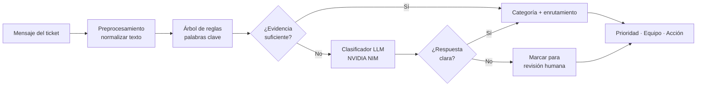
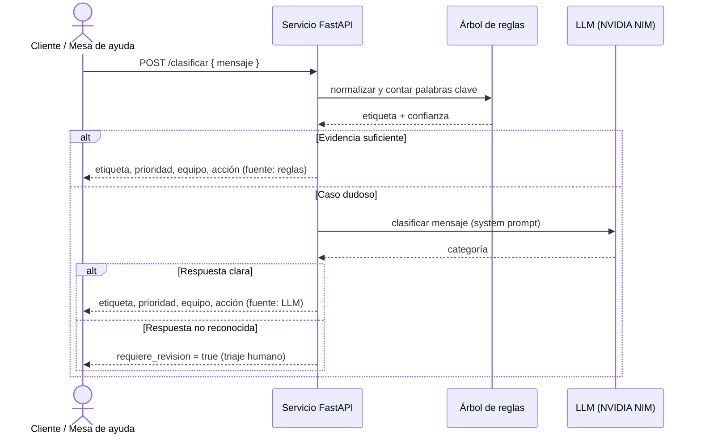

# Asistente de clasificación de correos / tickets de soporte

> **Curso:** Inteligencia Artificial
> **Autores:** _(completar con los integrantes del equipo)_
> **Fecha:** 12 de noviembre de 2026

Clasificador híbrido que asigna a cada mensaje de soporte una categoría
—**urgente**, **consulta**, **queja** u **otro**— y sugiere su enrutamiento.
Combina un **árbol de decisión sobre palabras clave** con un **LLM** (NVIDIA
NIM), y se expone como un **servicio web con interfaz interactiva**.

---

## 1. Introducción

Las áreas de soporte reciben a diario un gran volumen de correos y tickets. Si
un incidente **urgente** (por ejemplo, un sistema caído) se mezcla con consultas
rutinarias, la respuesta se retrasa y el impacto crece. Clasificar y priorizar
manualmente cada mensaje es lento, inconsistente y no escala.

Este proyecto automatiza esa primera clasificación y la convierte en una
**acción de enrutamiento** (a qué equipo va el ticket y con qué prioridad).
Compara dos enfoques —un baseline clásico de palabras clave y un LLM— y los
integra en una arquitectura híbrida que equilibra **costo, latencia y
precisión**, lista para usarse como un microservicio real.

## 2. Objetivo

**General:** construir un asistente que clasifique mensajes de soporte en
categorías accionables y recomiende su enrutamiento.

**Específicos (medibles):**
1. Etiquetar a mano un conjunto de 100 mensajes y medir el baseline de palabras
   clave con **precision, recall y F1** por clase.
2. Integrar un **clasificador LLM** (NVIDIA NIM) para resolver los casos que el
   baseline no decide con confianza.
3. Exponer el clasificador como un **servicio web** (API + interfaz) que
   devuelva categoría, prioridad, equipo y acción para cada mensaje.

## 3. Descripción de los datos

- **Fuente y obtención:** conjunto sintético de mensajes de soporte en español,
  redactado y **etiquetado a mano** para este proyecto (no contiene datos
  reales de clientes).
- **Formato y tamaño:** archivo `servicio_tickets/tickets_dataset.csv`, 100
  filas, 2 columnas.
- **Preprocesamiento:** normalización del texto a minúsculas y sin tildes para
  comparar palabras clave de forma robusta. No requiere más limpieza.

| Aspecto            | Detalle                                             |
|--------------------|-----------------------------------------------------|
| Nº de ejemplos     | 100 mensajes                                        |
| Variables          | `mensaje` (texto), `etiqueta` (clase)               |
| Clases y balance   | urgente: 33 · consulta: 34 · queja: 33              |
| Idioma             | Español                                             |
| Licencia / uso     | Datos sintéticos propios, uso educativo libre       |

- **Limitaciones y sesgos conocidos:** el dataset es pequeño y sintético, por lo
  que no cubre toda la variedad del lenguaje real (ironía, errores, mezcla de
  idiomas, emojis). Las métricas obtenidas sobre él son **optimistas** respecto
  a datos de producción (ver §6). El dataset etiquetado no incluye la clase
  `otro`, que el servicio sí maneja para saludos/spam.

## 4. Metodología

**Etapas del pipeline:**

1. **Preparación de datos.** Carga del CSV y normalización del texto.
2. **Modelado — baseline.** Árbol de decisión sobre **palabras clave**: una
   secuencia de preguntas (¿hay señales de urgencia? ¿de queja? ¿es una
   pregunta?) que asigna la categoría. Es rápido, gratuito y transparente.
3. **Modelado — LLM.** Cliente compatible con OpenAI apuntando a **NVIDIA NIM**;
   un *system prompt* define las categorías y pide una sola palabra de salida.
4. **Clasificador híbrido.** Las reglas resuelven los casos claros; los dudosos
   (poca evidencia de palabras clave) se envían al LLM. Si ninguno decide con
   claridad, el ticket se marca para **revisión humana** en lugar de asignarle
   una categoría a ciegas.
5. **Evaluación.** Métricas de clasificación: **precision, recall y F1** por
   clase y promedio *macro*, más la matriz de confusión.
6. **Despliegue.** El clasificador se empaqueta en un servicio **FastAPI** con
   endpoints REST y una interfaz web interactiva.

**Justificación de decisiones principales:**
- **Métricas:** al ser un problema de **clasificación**, se usan precision,
  recall y F1 (no MAE/RMSE, propios de regresión).
- **Baseline de palabras clave:** sirve de referencia barata y explicable frente
  a la cual medir el valor del LLM.
- **Enfoque híbrido:** usar el LLM solo en casos dudosos reduce costo y latencia
  manteniendo la precisión en los casos difíciles.
- **Humano en el bucle:** un ticket urgente mal clasificado es el error más
  costoso; por eso no hay *fallback* silencioso a una categoría de baja
  prioridad.

**Diagrama de flujo metodológico**



## 5. Diagrama de interacción (UML)

**En producción**, un sistema de mesa de ayuda (Zendesk, Freshdesk, un
formulario web, etc.) envía el texto del ticket al servicio por HTTP. El
servicio lo clasifica con el enfoque híbrido —consultando el LLM de NVIDIA solo
cuando hace falta— y responde con la categoría y el enrutamiento sugerido, que
el sistema usa para asignar y priorizar el ticket.

**Diagrama de secuencia**



## 6. Resultados

Evaluación del **baseline (árbol de palabras clave)** sobre los 100 mensajes
etiquetados a mano (3 clases del dataset):

| Clase    | Precision | Recall | F1   | n   |
|----------|-----------|--------|------|-----|
| urgente  | 0.97      | 1.00   | 0.99 | 33  |
| consulta | 0.94      | 1.00   | 0.97 | 34  |
| queja    | 1.00      | 0.91   | 0.95 | 33  |
| **Global** | **Accuracy 0.97** | | **F1 macro 0.97** | 100 |

**Matriz de confusión** (fila = real, columna = predicho):

|            | urgente | consulta | queja |
|------------|:-------:|:--------:|:-----:|
| **urgente**  | 33 | 0  | 0  |
| **consulta** | 0  | 34 | 0  |
| **queja**    | 1  | 2  | 30 |

**Análisis corto:**
- **Qué funcionó:** el baseline de palabras clave alcanza un F1 macro de 0.97 en
  este dataset; detecta todos los `urgente` (recall 1.00), lo más importante para
  el negocio.
- **Qué no:** confunde algunas `queja` con `consulta`/`urgente` cuando el mensaje
  no usa vocabulario de reclamo explícito (3 errores, todos en la clase queja).
  Esos casos ambiguos son precisamente los que el **LLM** y el estado de
  **revisión humana** cubren en el servicio híbrido.
- **Limitaciones:** el 0.97 se midió sobre los **mismos datos** con los que se
  afinaron las palabras clave, por lo que **sobreestima** el rendimiento real
  (riesgo de sobreajuste). La "confianza" es un conteo de palabras clave **no
  calibrado**; el umbral se fijó por criterio, no con un conjunto de validación.
  La comparación cuantitativa directa con el LLM requiere ejecutarlo con una API
  key (no incluida); el servicio registra la `fuente` de cada decisión para
  poder auditarla.

## 7. Reproducibilidad

**Requisitos:** Python 3.10+ y las dependencias de `servicio_tickets/requirements.txt`
(FastAPI, uvicorn, pydantic; `openai` y `python-dotenv` para el LLM).

**Instalación y ejecución (comandos mínimos):**

```bash
cd servicio_tickets
pip install -r requirements.txt

# Opción A — interfaz web interactiva
uvicorn app:app --reload        # abre http://127.0.0.1:8000/

# Opción B — demo por consola (sin servidor)
python demo.py
```

**Activar el LLM (opcional):**

```bash
cp .env.example .env            # edita .env y pega tu NVIDIA_API_KEY
```

> ⚠️ **Seguridad:** nunca compartas tu `.env` real ni lo incluyas en un ZIP (el
> `.gitignore` no protege archivos comprimidos). Si expones la clave, revócala y
> genera una nueva en NVIDIA Build.

**Estructura del repositorio:**

```
.
├── README.md                     # este documento
└── servicio_tickets/
    ├── clasificador.py           # lógica: reglas + LLM + híbrido + enrutamiento
    ├── app.py                    # API FastAPI y servidor de la interfaz
    ├── static/index.html         # interfaz web interactiva
    ├── demo.py                   # prueba por consola, sin servidor
    ├── tickets_dataset.csv       # 100 mensajes etiquetados a mano
    ├── requirements.txt          # dependencias
    ├── .env.example              # plantilla para la API key
    └── README.md                 # detalle técnico del servicio
```
